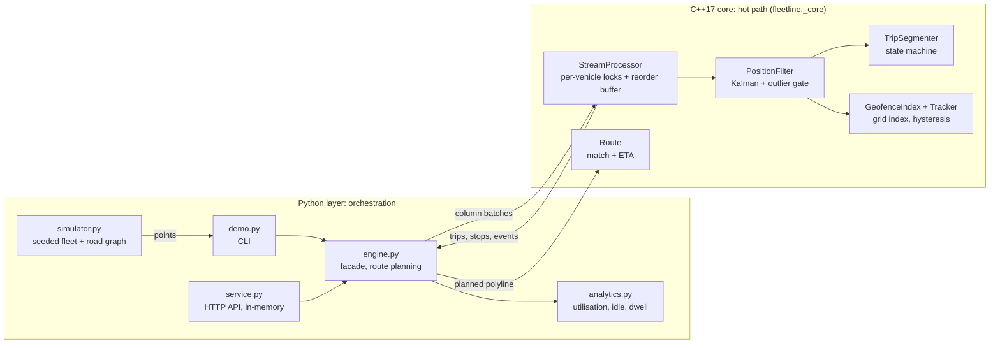

# fleetline

Fleet telematics engine: a C++17 core for GPS stream processing (route matching, geofencing, trip segmentation, ETA) exposed to Python, with an HTTP service and fleet analytics on top.


## What it demonstrates

- **Noise filtering with outlier rejection**: a constant-velocity Kalman filter on a local tangent plane, split into two independent 2x2 filters per axis, gated by implied speed between raw fixes, with automatic re-initialisation when the earlier track turns out to be the bad one.
- **Geofencing at scale**: winding-number point-in-polygon (correct for concave and self-overlapping shapes), circles, a uniform-grid spatial index, and an enter/exit/dwell state machine with spatial hysteresis so boundary jitter cannot cause event storms.
- **Trip segmentation**: a Parked / Driving / Pausing state machine on ignition, speed and stop duration, with speed hysteresis, per-trip haversine distance, idle time, and debounced harsh braking and acceleration events.
- **ETA along a route**: nearest-segment matching with a progress bias for routes that revisit a street, per-segment speed profile, and a pace blend of profile speed and observed recent speed whose weight decays with remaining distance.
- **Concurrent out-of-order ingestion**: a thread-safe stream processor with per-vehicle locks, an event-time reorder buffer (min-heap plus watermark), bounded memory, and explicit late and duplicate accounting.
- **A narrow native boundary**: column-oriented batch ingestion that crosses into C++ once per batch and releases the interpreter lock, so Python threads ingest in parallel.
- **Deterministic simulation for testing**: a seeded fleet simulator on a synthetic road graph (grid streets, arterials, ring road) with kinematics, red lights, idling habits, GPS noise, position jumps and simulated network delay.

## Architecture



Every GPS fix goes through the C++ core exactly once: reorder buffer, filter, trip state machine, geofence tracker. Results (trips, stops, geofence events, live status) are kept per vehicle inside the core and copied out as small value objects on query. The Python layer never touches individual points on the hot path; it plans routes on the road graph (a cold, per-query operation), shapes HTTP requests and responses, and turns core results into data frames for reporting. `core/` is a standalone CMake project with its own unit tests and no Python dependency.

## Quickstart

Requirements: a C++17 compiler, CMake 3.20+, GoogleTest (`libgtest-dev`), Python 3.10+. Python dependencies (pybind11, scikit-build-core, FastAPI, pandas, uvicorn, pytest, httpx) are installed by pip.

```bash
# C++ core and its unit tests
cmake -S core -B build/core -DCMAKE_BUILD_TYPE=Release
cmake --build build/core -j"$(nproc)"
ctest --test-dir build/core --output-on-failure

# Python package (builds the extension with scikit-build-core + pybind11)
python3 -m venv .venv
.venv/bin/pip install -e ".[dev]"
.venv/bin/pytest

# Demo: 12 vehicles, 10 simulated hours, printed reports
.venv/bin/python -m fleetline.demo --vehicles 12 --hours 10 --seed 7

# HTTP service (empty in-memory store; POST /points to feed it)
.venv/bin/python -m uvicorn fleetline.service:app --port 8000
```

Abridged demo output:

```
fleetline demo: 12 vehicles, 10 simulated hours from 2026-03-02 06:00 UTC, seed 7
simulated 103,504 points in 0.63s; core processed 103,504 in 0.05s (1,936,747 points/s)
late dropped: 0, duplicates: 0, GPS outliers rejected: 99, trips: 299

Utilisation per vehicle
            trips  distance_km  driving_h  idle_h  utilisation_pct  avg_speed_kmh  harsh_events
VAN-003        29        123.1       3.80    2.92             38.0           32.4             0
TRK-012        25        104.8       3.64    2.56             36.4           28.8             0
...
Geofence dwell report
                          fence  visits  vehicles  completed  mean_dwell_min  max_dwell_min  dwell_alerts
old-town  Old town (restricted)     174        12        174             5.1           47.2            11
fuel               Fuel station      52        12         52            12.9           26.4            48
...
```

API endpoints: `POST /points`, `POST /flush`, `GET /vehicles`, `GET /vehicles/{id}`, `GET /vehicles/{id}/trips`, `GET /vehicles/{id}/stops`, `GET /vehicles/{id}/eta?place=depot` (or `?lat=..&lon=..`), `GET /geofences`, `PUT /geofences/{id}`, `GET /geofence-events?vehicle_id=&fence_id=&type=`, `GET /health`. Interactive docs are served at `/docs`.

## Design decisions

1. **C++ for the per-point hot path, Python for orchestration.**
   *Decision*: everything that runs once per GPS fix (filtering, outlier gate, state machines, point-in-fence tests, reorder buffer) lives in C++; route planning, HTTP, simulation and reporting live in Python.
   *Why*: a fleet of a few thousand vehicles reporting every 2 s is a steady thousands of points per second with bursts after connectivity gaps, and each point touches several state machines. That work is branchy, stateful and small-grained, which is the worst case for an interpreter and the best case for compiled code. The work that remains in Python runs per query or per report, where developer speed and the data-frame ecosystem matter more than microseconds. The demo processes about 1.9 million points per second through the full pipeline on one core.
   *Trade-off*: two languages, a build step for the extension, and a binding layer to keep in sync. The boundary is kept narrow on purpose (value structs out, column batches in) so that cost stays small.

2. **Uniform grid instead of an R-tree for the geofence index.**
   *Decision*: fences are registered in every grid cell their bounding box (expanded by the hysteresis margin) overlaps; a query reads exactly one cell.
   *Why*: city fleets have hundreds to low thousands of fences of broadly similar size, and the query is always a point. A grid gives O(1) lookups with no tree balancing, is trivial to update when a fence changes, and its memory is easy to bound. Expanding by the hysteresis margin means a vehicle just outside a fence still sees it as a candidate, which the exit logic needs.
   *Trade-off*: a grid degrades when fence sizes vary by orders of magnitude (a country-sized fence lands in thousands of cells). An R-tree or a two-level grid would handle that; the cell size is a parameter, not adaptive.

3. **Hysteresis everywhere a threshold meets noise.**
   *Decision*: geofences use a spatial band (enter only when 15 m inside, exit only when 15 m outside); trips use asymmetric speed thresholds (start at 2.5 m/s, stationary below 1.0 m/s) plus time thresholds (3 min stopped or 1 min ignition off).
   *Why*: GPS error is several metres and device speed jitters around zero. A single threshold turns a parked vehicle near a fence edge into dozens of enter/exit pairs, and a vehicle creeping in traffic into dozens of micro-trips. The tests replay exactly those cases.
   *Trade-off*: events are delayed by the band (an enter is reported a few seconds after the true crossing), and fences narrower than twice the band cannot be entered. Both are tunable per deployment.

4. **Per-vehicle event-time reorder buffer; drop late points, never rewind.**
   *Decision*: points wait in a per-vehicle min-heap until the vehicle's watermark (max event time seen minus a 30 s window) passes them. A point older than the last processed one is counted as late and dropped. A size cap forces release under pathological delay.
   *Why*: the filter and state machines are strictly forward in time; supporting rewind would mean snapshotting and replaying every stateful component. Mobile networks deliver most points within seconds, so a short window catches nearly all reordering, and the late counter makes the remainder observable. Watermarks are per vehicle because vehicles have independent connectivity.
   *Trade-off*: live status lags real time by the window, and a truly late point (for example a store-and-forward dump after a tunnel) is lost for trip metrics. A production system would route those to a batch reconciliation path.

5. **Constant-velocity Kalman filter split per axis, with a raw-to-raw outlier gate.**
   *Decision*: positions are projected to a local tangent plane and filtered by two 2x2 filters (position, velocity) instead of one 4x4. Outliers are gated by implied speed from the last accepted raw fix, with an allowance for two fixes' worth of noise; three consecutive rejections re-initialise the filter on the new track.
   *Why*: with diagonal measurement noise and the same motion model on both axes the 4x4 covariance is block diagonal, so the split is exact and cheaper. Gating raw to raw (not filtered to raw) keeps the gate from rejecting real hard manoeuvres while the filter lags. The re-initialisation rule handles the classic failure where the first fix after a cold start is the wrong one and every correct fix after it looks like an outlier.
   *Trade-off*: the motion model ignores turning, so the filter lags briefly at corners; the projection is accurate at city scale but not across hundreds of kilometres.

6. **Coarse locks per vehicle, interpreter lock released at the boundary.**
   *Decision*: a shared mutex guards the vehicle map (exclusive only to add a vehicle), each vehicle has its own mutex, and the geofence index has a reader-writer lock. Every bound method that locks releases the Python interpreter lock first; batch ingestion takes columns, not objects.
   *Why*: the natural unit of ordering is the vehicle, so per-vehicle locks give parallelism across vehicles with no ordering hazards within one. Releasing the interpreter lock lets concurrent request handlers ingest in parallel, and column batches avoid creating a Python object per point. A fixed lock order (vehicle, then index) rules out deadlock.
   *Trade-off*: a single very chatty vehicle cannot be parallelised, and the column API is less convenient than passing objects (both are offered).

## Scope and limits

- No real map data or full map matching: ETA routes are planned on a synthetic road graph, and matching only snaps to the planned polyline. A real deployment would run a hidden-Markov-model map matcher against a road network.
- No persistence: the service and core are in-memory and single process. There is no recovery of open trips after restart.
- No authentication, rate limiting or multi-tenant separation in the HTTP API.
- The speed profile is static per road class; there is no learned historical traffic model.
- Late points beyond the reorder window are counted and dropped rather than reconciled.
- The filter uses a constant-velocity model with fixed noise parameters, not an adaptive or interacting-multiple-model filter.

## About this lab

A compact reference implementation written in 2026. It reconstructs, on synthetic data, patterns I have used in production systems (native stream processing behind a Python orchestration layer, noisy sensor filtering, spatial indexing and event state machines), without reproducing any proprietary design.

## License

MIT. See [LICENSE](LICENSE).
